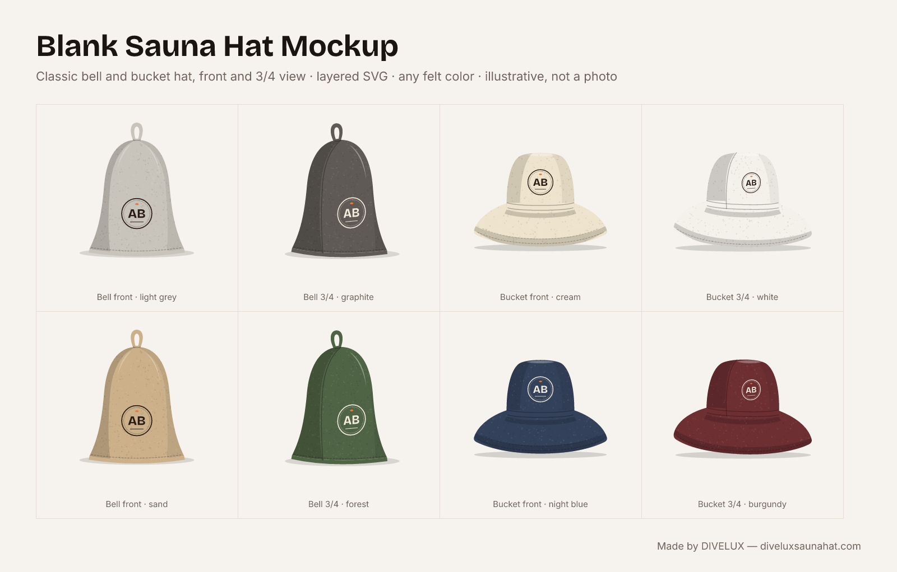

# Blank Sauna Hat Mockup

A layered vector mockup of a plain wool felt sauna hat, for trying out an embroidery, a monogram, a patch or a print
before you make it. Two shapes (classic bell and bucket hat with a brim), each seen from the front and at 3/4.

This is an illustrative mockup drawn as flat vector shapes. It is not a photo, and it does not show any real hat
exactly. Use it to judge placement and color, then check on a real hat.

Made by DIVELUX, makers of handmade wool sauna hats — https://diveluxsaunahat.com



## What is inside

| Path | What it is |
|---|---|
| `svg/classic-bell-hat-front.svg` | bell hat, front, with the hanging loop |
| `svg/classic-bell-hat-three-quarter.svg` | bell hat, 3/4 view, side seam visible |
| `svg/bucket-hat-front.svg` | bucket hat with brim, front |
| `svg/bucket-hat-three-quarter.svg` | bucket hat, 3/4 view |
| `png/*.png` | 2000 x 2000 renders, transparent background, with the sample design |
| `png/*-blank.png` | the same renders with an empty design area |
| `preview.png` | all four views in eight sample felt colors |
| `layers.png` | how the layers stack, step by step |
| `src/build.py` | the script that draws everything |
| `LICENSE` | CC BY 4.0 for the artwork, MIT for the script |

## The layers

Every SVG is 1000 x 1000 and has the same named groups, bottom to top:

| Group | What it does |
|---|---|
| `ground-shadow` | soft shadow under the hat; delete it for a cut-out |
| `base-felt` | the hat; all its shapes take ONE fill set on this group |
| `design-area` | your artwork goes here; it is clipped to the dashed zone |
| `placeholder-design` | (inside `design-area`) the sample "AB" monogram; delete it |
| `felt-texture` | fine speckles at 9% opacity so the felt does not look like plastic |
| `shading` | flat dark and light shapes with opacity; they fall over your design too |
| `seams-and-loop` | stitch lines along the edge, the side seam, the base of the loop |
| `design-area-guide` | dashed outline of the zone; hide it before you export |

No filters, gradients, masks or embedded images: only flat shapes, opacity and two clip paths.

## Put your design on the hat

**Figma.** Drag the SVG onto the canvas. Open the `design-area` group, delete `placeholder-design` and paste your
artwork inside the group (it is clipped to the zone automatically). To make the felt grain show through a
printed-looking design, set your artwork's layer blend mode to Multiply. Hide `design-area-guide` and export.

**Illustrator.** File > Open the SVG. In the Layers panel open `design-area`, delete `placeholder-design`, place your
art inside the clip group (paste in place, then drag it under the clipping path). Use Multiply in the Transparency
panel for a print look; keep Normal for embroidery and patches.

**Inkscape.** Open the SVG, Object > Layers and Objects. Enter the `design-area` group (double-click), delete the
placeholder, paste your art. The clip stays on the group.

**3/4 views.** The sample design there sits in a slightly skewed group so it follows the turn of the hat. Put your art
inside that same group, or apply a similar skew (about −4° to −5° vertical) and a 92% horizontal scale.

## Change the felt color

Select the `base-felt` group and change its fill (in code: the `fill` attribute on `<g id="base-felt">`). Shading,
texture and stitches are black or white with opacity, so they work on any color. `preview.png` shows light grey,
graphite, cream, white, sand, forest green, night blue and burgundy; these are only examples.

## Sizes

The art is drawn to look right, not measured from a pattern. As a rough guide, if a hat is about 24 in around at
the rim, the dashed front zone on the bell hat is about 4 to 5 in wide. Measure your own hat before you digitize an
embroidery file.

## Rebuild

```
pip install resvg-py fonttools
python3 src/build.py
```

## License

Artwork: CC BY 4.0 (Creative Commons Attribution 4.0 International). Credit: "Mockup by DIVELUX —
diveluxsaunahat.com". Script: MIT. The DIVELUX name and logo are not covered by the license. Your own design on top
of the mockup stays yours. See `LICENSE`.

More free sauna tools: https://diveluxsaunahat.com/pages/sauna-tools
